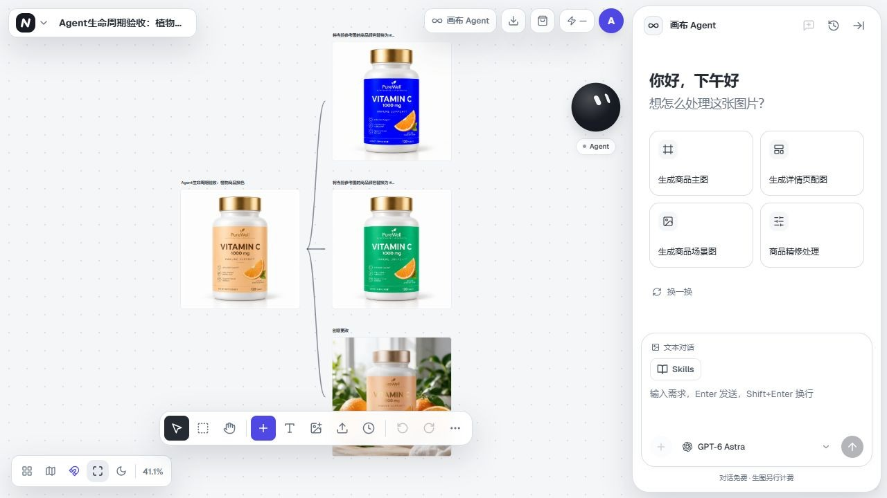
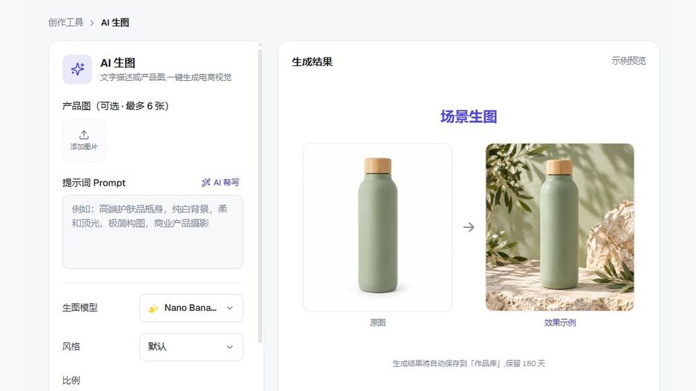
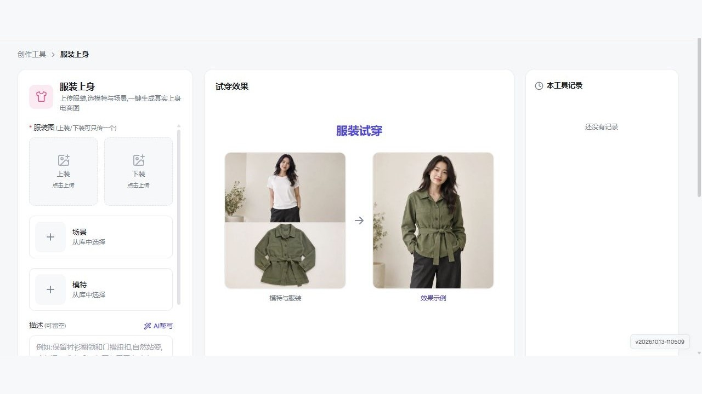
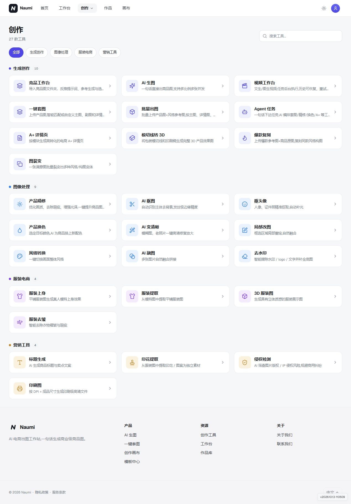
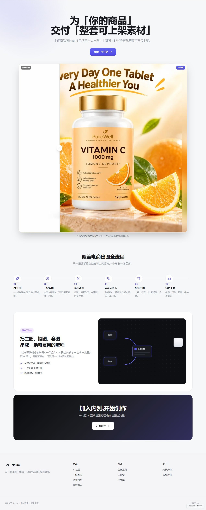

<div align="center">


# AI 电商视觉工作站

**商品生图 · 可视化画布 · 创作 Agent · 批量生产**

Self-hosted AI visual studio for e-commerce.

[界面预览](#界面预览) · [功能](#功能) · [快速开始](#快速开始) · [配置](#配置) · [开发与发布](#开发与发布) · [文档](#文档)

</div>



Naumi 把商品图片、提示词、生成结果和图像工具放在同一个创作流程中。你可以直接出图，也可以在画布上连接图片与文字节点，通过 Agent 或批量任务继续处理，最后保存、复用和导出素材。

## 功能

| 模块 | 你可以做什么 |
|---|---|
| **AI 生图** | 输入描述或商品参考图，选择管理员发布的模型及其支持的比例、分辨率与质量；支持多张生成和对话式迭代。 |
| **创作画布** | 组织图片、文字和连线，使用节点操作、框选分组、历史选图、撤销重做与画布整理；生成过程中可继续编辑或在其他节点提交任务。 |
| **创作 Agent** | 在独立任务页或画布侧栏对话，结合当前参考素材调用创作工具，显示过程与结果，保留会话历史。 |
| **生图 Skills** | 选择商品白底、场景、套组、精修、换色、海报等精选技能；创建、导入和管理自己的创作技能。 |
| **批量与套图** | 组合产品图与风格参考，生成主图、详情图、SKU 或模板套组；已提交的批量任务后台执行，可返回查看和下载。 |
| **竞品工作台** | 导入参考图片或文件夹，管理素材、反推提示词、参考生图及选区编辑。 |
| **作品与团队** | 保存作品与项目，查看任务历史、积分与用量；通过团队和子账号管理协作访问。 |
| **管理后台** | 管理模型与供应商、参数和价格、模板与提示词、用户和积分，以及站点品牌与服务配置。 |

当前创作工具中心提供 **27 个入口**，分为生成创作、图像处理、服装电商和营销工具四类：

- **生成创作**：生图、视频、套图、批量、Agent、A+ 详情页、包装模切线转 3D、参考复刻与图裂变等。
- **图像处理**：商品精修、抠图、抠头像、换色、高清放大、局部编辑、风格转换、融图和去水印。
- **服装电商**：虚拟试穿、服装提取、立体展示和去皱。
- **营销工具**：商品标题、印花提取、印刷文件与图像侵权风险辅助筛查。

工具入口不等于供应商已经配置或每项效果都已验收。实际模型能力、可用参数、计费和视频可用性以实例配置为准；侵权筛查是辅助信息，不是法律结论。

### 工作流与执行边界

- **跨画布迁移**：支持识别稿定剪贴板工作流中的兼容元素并导入；素材原链接失效时保留元数据占位，可后续补图。不是任意第三方格式的无损转换。
- **任务与积分**：生成、批量和 Agent 工具接入任务及计费流程；离开页面不代表取消已提交任务，操作前应核对实际报价。
- **服务端 Harness**：Agent 执行经过会话与资源归属、工具能力、输入参数、报价确认和出站网络边界检查；参考图、历史和技能文本不作为授权来源。它是分层防护，不是“绝对防注入”的保证。
- **加载与缓存**：画布按需加载媒体，并使用账号隔离的浏览器元数据缓存；写入和权限仍由服务端处理，不把缓存当作永久离线副本。

## 界面预览

下图均为 **2026-10-13 实际界面截图**，不是概念效果图。拍摄实例版本为 `2026.10.13-110509`，源码说明按本次最新 main 核对。模型名称、价格和内容属于该实例配置，不代表默认值。图片来源和裁切记录见 [截图说明](docs/README_MEDIA.md)。

<table>
  <tr>
    <td width="50%" valign="top">
      
      <br /><b>商品生图</b><br />参考图、描述与模型参数集中配置。
    </td>
    <td width="50%" valign="top">
      
      <br /><b>服装试穿</b><br />选择服装、模特和场景，查看处理结果。
    </td>
  </tr>
  <tr>
    <td width="50%" valign="top">
      
      <br /><b>创作 Skills</b><br />把常用创作方法保存为可复用技能。
    </td>
    <td width="50%" valign="top">
      
      <br /><b>批量工作台</b><br />用统一设置提交多个商品任务。
    </td>
  </tr>
</table>

<details>
<summary><b>查看工具中心与首页</b></summary>

### 创作工具中心



### 站点首页



</details>

截图中的工具效果是页面已有示例，画布采用已有验收项目；本次截图没有新提交付费生成，也不构成对全部供应商或工具效果的重新验收。

## 快速开始

### 新建自托管实例

准备 Linux、Git、Docker、Docker Compose v2 和 OpenSSL。以下是**新实例安装**流程：

```bash
git clone https://github.com/JesstLe/naumi.git
cd naumi
# 先阅读安装器，再执行。
less install.sh
bash install.sh
```

安装器会准备 `.env`、生成独立设置加密密钥与 Worker 密钥，尝试拉取预构建镜像，失败时回退到本地构建；也会按网络情况检查镜像源。它会识别既有安装并执行更新，**不要把它当作在线服务无中断发布工具**。

| 启动方式 | Web 端口 |
|---|---|
| 安装器首次安装 | 默认 `80`，占用时采用 `8080`；已有实例沿用保存的端口。 |
| 直接运行仓库 Compose | 默认 `3012`，通过 `HTTP_PORT` 调整。 |

按安装输出访问 Web 入口，完成首启向导中的管理员账号、站点名称和模型连接配置，然后进入后台发布实际可用的模型。数据库、Worker 和模型管理接口不应开放为公共 Web 服务。

### 本地开发

项目 Docker 构建使用 Node.js 20；本地可使用相同主版本。准备独立 PostgreSQL 数据库：

```bash
npm ci
cp .env.example .env.local
# 编辑 .env.local，配置 DATABASE_URL、SETTINGS_SECRET、VIDEO_WORKER_SECRET。
# 两个密钥分别使用独立的 openssl rand -hex 32 输出。
npm run dev
```

默认访问 `http://localhost:3000`。Windows 可在 PowerShell 使用 `Copy-Item .env.example .env.local`。模型和专用处理服务另行配置；本地开发数据库与线上实例保持独立。

## 配置

完整字段见 [.env.example](.env.example)，容器注入项以 [docker-compose.yml](docker-compose.yml) 为准。单独在 `.env` 增加字段不意味着 Compose 已将其传入应用。

| 配置项 | 用途 |
|---|---|
| `DATABASE_URL` | PostgreSQL 业务数据库；账号、作品、任务、积分和设置在服务端持久化。 |
| `SETTINGS_SECRET` | 会话签名与敏感设置加密；既有实例保持原值，轮换必须迁移已有密文。 |
| `VIDEO_WORKER_SECRET` | 应用与独立 Worker 的内部鉴权。 |
| `OPENAI_BASE_URL` / `OPENAI_API_KEY` | 图片模型兼容通道；也可通过后台维护实际执行配置。 |
| `AGENT_BASE_URL` / `AGENT_API_KEY` / `AGENT_MODEL` | 独立 Agent 文本通道，不自动覆盖图片通道。 |
| `AGENT_BACKEND` | Agent 桥接实现，默认 `pi`；其他后端需各自接入与验收。 |
| `STORAGE_DRIVER` | `local`、`r2` 或 `s3`；配套存储字段和权限须完整。 |
| `MEDIA_PRIVATE` | 配合实例的私有媒体与签名访问设置，不能只改开关后假定权限已配置。 |
| `HTTP_PORT` | Compose 对外应用端口；公网入口可由反向代理统一承接。 |
| `NAUMI_PUBLIC_COMMERCE` | 公开购买、充值及价格入口，按实例运营需求设置。 |

管理员维护的模型参数、能力和价格优先；上游资料用于有来源的兜底，不因目录刷新自动覆盖人工配置。详见 [模型配置](docs/model-configuration.md)、[画布管理员配置](docs/CANVAS_ADMIN_MODEL_CONFIGURATION.md) 和 [供应商元数据](docs/supplier-model-metadata.md)。

### 数据与媒体

- 默认 Compose 包含 PostgreSQL、App 和独立视频 Worker，使用 `pgdata`、`media` 持久化卷；应用媒体目录为 `/data/media`。
- 默认 Compose 使用本地媒体。代码支持 R2 和 S3 兼容存储；切换时需要配置、访问权限和历史媒体迁移，不能只改驱动后丢掉旧路径。
- 私有媒体的签名读取、直传和缩略能力取决于实际实例的网关与存储配置，不把某个测试站配置当作默认安装结果。
- 备份需同时保留数据库、媒体、运行配置和加密密钥；更新代码不以旧数据库覆盖当前业务数据。

### 品牌与入口

后台可配置运行时站点名称与 Logo；部分 favicon、画布标识及 `NEXT_PUBLIC_*` 变量在构建期生效。域名和 HTTPS 通过实际部署的反向代理配置，不在 README 固定第三方服务地址。

## 开发与发布

### 技术栈

Next.js 14 App Router · React 18 · TypeScript · Tailwind CSS · React Flow · PostgreSQL · OpenAI 兼容接口 · Replicate · 本地 / R2 / S3 兼容存储

```text
src/app/                 页面与 API 路由
src/components/          画布、工具工作台与后台组件
src/lib/agent/           Agent 桥接、工具与 Harness
src/lib/image-skills/    创作 Skills
src/lib/model-config/    模型配置与执行映射
src/lib/billing/         积分与计费
src/lib/canvas/          画布数据与工作流支持
scripts/                 Worker、验证与发布工具
docs/                    实现、交接与验收记录
```

### 协作与验证

从独立 `codex/` 分支/worktree 开工，刷新远端 main，保护他人未提交内容，选择性提交。按模块完成开发后集中测试；每累计三次功能迭代整合一次远端 main。详见 [协作说明](docs/AGENT_COLLABORATION.md) 与 [AGENTS.md](AGENTS.md)。

```bash
npm run build
# 按本轮改动选择对应验证，不把下面列表当作全部功能验收。
npm run verify:image-skills
npm run verify:model-management
```

### 现有实例更新

**当前默认更新目标是103；120已废弃。** 这只是项目维护约定，不是公开安装所需的服务器配置，也不授权自动更新其他站点。

发布前阅读 [连续可用发布手册](docs/RELEASE_RUNBOOK.md)：固定版本、整合同事已完成提交、目标站全程部署锁、备份与回滚、真实就绪和受影响功能验收。蓝绿切流、活动 Agent 会话归属、在途 Worker 排空和旧前端资源保留是已确认标准，**相关工程尚未完成，现有重建流程不等于无感发布**。

已有服务不应先停旧 App 再等待构建；跨站数据合并、存储迁移和破坏性 DDL 分开安排。源代码更新不自动迁移数据库、媒体或秘密。

## 文档

| 主题 | 入口 |
|---|---|
| 画布与工作流 | [画布状态](docs/CANVAS_STATUS.md) · [工作流集成](docs/CANVAS_WORKFLOW_INTEGRATION.md) |
| Agent 与防护 | [Agent](docs/agent.md) · [Harness 交付记录](docs/changes/2026-10-13-agent-harness-release.md) |
| 模型与供应商 | [模型管理](docs/admin-model-management.md) · [供应商模型资料](docs/supplier-model-metadata.md) |
| 计费与积分 | [计费入口](docs/billing-entrypoints.md) · [计价服务](docs/pricing-service.md) |
| 图片与展示 | [本次截图来源](docs/README_MEDIA.md) · [README 更新记录](docs/changes/2026-10-13-readme-refresh.md) |
| 部署与接手 | [发布手册](docs/RELEASE_RUNBOOK.md) · [协作说明](docs/AGENT_COLLABORATION.md) · [103目标约定](docs/changes/2026-10-13-retire-120-default-103.md) |

历史实现文档与运行环境可能不同；冲突时按最新用户指令、当前源码和实际配置核对，不用旧验收替代新版本验收。

## License

本仓库保留 **GNU AGPL-3.0**，完整条款见 [LICENSE](LICENSE)。模型、图片处理和存储服务的使用条件及费用由各自提供方决定。私有部署或企业定制不自动改变本仓库许可证。
