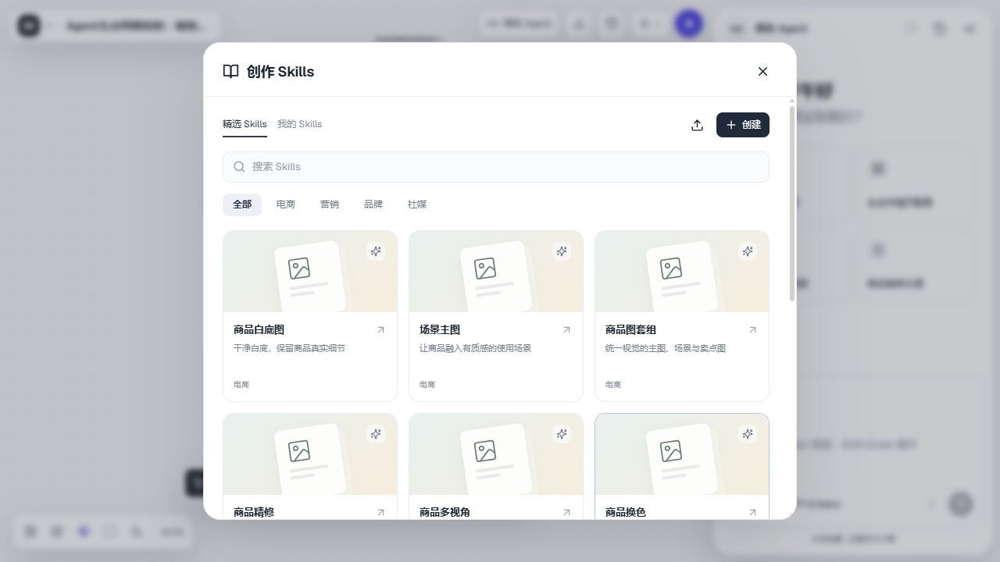

<div align="center">


# AI 电商视觉工作站

**商品生图 · 可视化画布 · 创作 Agent · 批量生产**

Self-hosted AI visual studio for e-commerce.

[界面预览](#界面预览) · [功能](#功能) · [快速开始](#快速开始) · [配置](#配置) · [开发与发布](#开发与发布) · [文档](#文档)

</div>


Naumi 把商品图片、提示词、生成结果和图像工具放在同一个创作流程中。你可以直接出图，也可以在画布上连接图片与文字节点，通过 Agent 或批量任务继续处理，最后保存、复用和导出素材。

本文按 **2026-10-17 的 main 源码**核对；功能说明描述仓库实现，不代表每个运行实例都已部署或启用。依赖版本以 [package.json](package.json) 和锁文件为准，界面图片保留原始拍摄日期。

## 功能

| 模块 | 你可以做什么 |
|---|---|
| **AI 生图与编辑** | 输入描述或商品参考图，选择管理员发布的模型与参数；统一计划、报价和提交链路支持生成、参考图编辑、蒙版处理、批次及本地输出处理。 |
| **创作画布** | 组织图片、文字、视频和连线，使用节点 Dock、框选分组、历史选图、撤销重做与画布整理；生成过程中可继续编辑或在其他节点提交任务。 |
| **创作 Agent** | 在独立任务页或画布侧栏对话，结合当前参考素材调用创作工具，显示过程与结果，保留会话历史。 |
| **生图 Skills** | 选择商品白底、场景、套组、精修、换色、海报等精选技能；创建、导入和管理自己的创作技能。 |
| **参考工作台与套图** | `/batchshot` 进入站内参考工作台，提供批量、单图及对话式生图页面；组合产品与风格素材，查看历史和导出素材。 |
| **视频与媒体处理** | 在视频工作台或画布视频节点维护提示词、模型及图片/视频/音频引用；支持生成任务、工作流，以及提帧、裁剪、拼接和音频提取等媒体任务。 |
| **竞品工作台** | 导入参考图片或文件夹，管理素材、反推提示词、参考生图及选区编辑。 |
| **品牌包装策略** | 根据产品简报整理包装定位、创意方向和 SKU 规则；包装效果图与模切线转 3D 使用各自的工具入口。 |
| **作品与团队** | 保存作品与项目，查看任务历史、积分与用量；通过团队和子账号管理协作访问。 |
| **管理后台** | 管理模型及供应商通道、能力与参数映射、供应商元数据和成本、积分计价、模板与提示词、用户权限、品牌及服务配置。 |
| **模型健康** | 聚合已配置模型的业务成功与失败，查看通道状态；可配置独立 Worker 执行有预算的低频真实生图巡检。 |

当前创作工具中心提供 **28 个入口**，分为生成创作、图像处理、服装电商和营销工具四类；清单来自 [工具目录](src/lib/tool-meta.ts)，账号实际可见入口受权限控制：

- **生成创作**：生图、视频、套图、参考工作台、Agent、品牌包装策略、A+ 详情页、包装模切线转 3D、参考复刻与图裂变等。
- **图像处理**：商品精修、抠图、抠头像、换色、高清放大、局部编辑、风格转换、融图和去水印。
- **服装电商**：虚拟试穿、服装提取、立体展示和去皱。
- **营销工具**：商品标题、印花提取、印刷文件与图像侵权风险辅助筛查。

工具入口不等于供应商已经配置或每项效果都已验收。实际模型能力、可用参数、计费和视频可用性以实例配置为准；侵权筛查是辅助信息，不是法律结论。

### 工作流与执行边界

- **计划与实际执行**：图像任务先核对素材归属、模型能力和参数，再冻结报价与执行配置；预览计划不等于提交生成。缺少已核实能力的通道不会因目录中出现同名模型而自动放行。
- **参考图与画幅**：自动比例按明确的参考/编辑目标角色解析，多参考歧义时要求用户选择；已接受任务不随新默认值重解释。图像生成路径保留返回画幅，不因比例参数默认裁切；显式像素输出采用完整画面适配，不保证供应商返回精确尺寸。
- **画布入口**：沿用图片节点 Dock 及现有工具操作，不再增加一套重复的“图像创作”悬浮面板；共享图像后端仍服务画布、Agent 和参考工作台。
- **跨画布迁移**：支持识别稿定剪贴板工作流中的兼容元素并导入；素材原链接失效时保留元数据占位，可后续补图。不是任意第三方格式的无损转换。
- **任务与积分**：生成、批量和 Agent 工具接入任务及计费流程；离开页面不代表取消已提交任务，操作前应核对实际报价。
- **服务端 Harness**：Agent 执行经过会话与资源归属、工具能力、输入参数、报价确认和出站网络边界检查；参考图、历史和技能文本不作为授权来源。它是分层防护，不是“绝对防注入”的保证。
- **加载与缓存**：图片展示路径使用账号隔离的 IndexedDB 图片字节缓存，并保留按需加载和会话失效处理；本地命中不代替服务端授权，也不等于永久离线副本。
- **视频能力**：生成协议、引用类型和参数由具体模型决定；本地媒体处理需要独立媒体 Worker。工具入口、模拟测试或镜像内含 FFmpeg，不等于某实例的视频供应商已验收。

## 界面预览

下图均为 **2026-10-13 实际界面截图**，不是概念效果图或 10 月 17 日新版截图。拍摄实例版本为 `2026.10.13-110509`；后续节点 Dock、视频与工具入口已有变化，旧工具中心图片中的 27 项不代表当前 28 项目录。模型名称、价格和内容属于拍摄实例配置，不代表默认值。图片来源和裁切记录见 [截图说明](docs/README_MEDIA.md)。

<table>
  <tr>
    <td width="50%" valign="top">
      
      <br /><b>商品生图</b><br />参考图、描述与模型参数集中配置。
    </td>
    <td width="50%" valign="top">
      
      <br /><b>服装试穿</b><br />选择服装、模特和场景，查看处理结果。
    </td>
  </tr>
  <tr>
    <td width="50%" valign="top">
      
      <br /><b>创作 Skills</b><br />把常用创作方法保存为可复用技能。
    </td>
    <td width="50%" valign="top">
      
      <br /><b>批量工作台</b><br />用统一设置提交多个商品任务。
    </td>
  </tr>
</table>

<details>
<summary><b>查看工具中心与首页</b></summary>

### 创作工具中心


### 站点首页


</details>

截图中的工具效果是页面已有示例，画布采用已有验收项目；本次截图没有新提交付费生成，也不构成对全部供应商或工具效果的重新验收。

## 快速开始

### 新建自托管实例

准备 Linux、Git、Docker、Docker Compose v2 和 OpenSSL。以下是**新实例安装**流程：

```bash
git clone https://github.com/JesstLe/naumi.git
cd naumi
# 先阅读安装器，再执行。
less install.sh
bash install.sh
```

安装器会准备 `.env`、生成独立设置加密密钥与 Worker 密钥，尝试拉取预构建镜像，失败时回退到本地构建；也会按网络情况检查镜像源。它会识别既有安装并执行更新，**不要把它当作在线服务无中断发布工具**。

| 启动方式 | Web 端口 |
|---|---|
| 安装器首次安装 | 默认 `80`，占用时采用 `8080`；已有实例沿用保存的端口。 |
| 直接运行仓库 Compose | 默认 `3012`，通过 `HTTP_PORT` 调整。 |

按安装输出访问 Web 入口，完成首启向导中的管理员账号、站点名称和模型连接配置，然后进入后台发布实际可用的模型。数据库、Worker 和模型管理接口不应开放为公共 Web 服务。

### 本地开发

项目 Docker 构建和运行使用 **Node.js 24**，本地建议使用相同主版本；默认 Compose 数据库为 **PostgreSQL 16**。本地开发先准备独立 PostgreSQL 数据库：

```bash
npm ci
cp .env.example .env.local
# 编辑 .env.local，配置 DATABASE_URL、SETTINGS_SECRET、VIDEO_WORKER_SECRET。
# 需要媒体处理时，另配置 MEDIA_WORKER_SECRET 和独立媒体 Worker。
# 各个密钥分别使用独立的 openssl rand -hex 32 输出。
npm run dev
```

默认访问 `http://localhost:3000`。`npm ci` 的 `postinstall` 会检查并应用当前 Next.js 请求体修补，`npm run dev` / `npm run build` 会先构建参考工作台静态资源；不要跳过安装脚本后直接假定资源与框架补丁齐备。Windows 可在 PowerShell 使用 `Copy-Item .env.example .env.local`。模型和专用处理服务另行配置；本地开发数据库与线上实例保持独立。

## 配置

完整字段见 [.env.example](.env.example)，容器注入项以 [docker-compose.yml](docker-compose.yml) 为准。单独在 `.env` 增加字段不意味着 Compose 已将其传入应用。

| 配置项 | 用途 |
|---|---|
| `DATABASE_URL` | PostgreSQL 业务数据库；账号、作品、任务、积分和设置在服务端持久化。 |
| `SETTINGS_SECRET` | 会话签名与敏感设置加密；既有实例保持原值，轮换必须迁移已有密文。 |
| `VIDEO_WORKER_SECRET` | 应用与独立 Worker 的内部鉴权。 |
| `MEDIA_WORKER_SECRET` / `MEDIA_WORKER_ORIGIN` | 媒体任务服务的独立鉴权和内部入口；密钥不复用设置或视频 Worker 密钥。 |
| `OPENAI_BASE_URL` / `OPENAI_API_KEY` | 图片模型兼容通道；也可通过后台维护实际执行配置。 |
| `AGENT_BASE_URL` / `AGENT_API_KEY` / `AGENT_MODEL` | 独立 Agent 文本通道，不自动覆盖图片通道。 |
| `AGENT_BACKEND` | Agent 桥接实现，默认 `pi`；其他后端需各自接入与验收。 |
| `VIDEO_API_*` / `VIDEO_PROVIDERS_JSON` | 视频供应商与模型配置；实际支持的引用、时长和参数按模型能力核验。 |
| `MODEL_HEALTH_WORKER_SECRET` | 应用与可选健康 Worker 的独立鉴权；默认 Compose 不自动启动该 Worker。 |
| `STORAGE_DRIVER` | `local`、`r2` 或 `s3`；配套存储字段和权限须完整。 |
| `MEDIA_PRIVATE` | 配合实例的私有媒体与签名访问设置，不能只改开关后假定权限已配置。 |
| `HTTP_PORT` | Compose 对外应用端口；公网入口可由反向代理统一承接。 |
| `NAUMI_PUBLIC_COMMERCE` | 公开购买、充值及价格入口，按实例运营需求设置。 |

管理员维护的模型参数、能力和价格优先；上游资料用于有来源的兜底，不因目录刷新自动覆盖人工配置。详见 [模型配置](docs/model-configuration.md)、[画布管理员配置](docs/CANVAS_ADMIN_MODEL_CONFIGURATION.md) 和 [供应商元数据](docs/supplier-model-metadata.md)。

### 通道与模型健康

管理入口为 `/admin/model-health`。只检查当前发布配置中的启用模型，不遍历供应商完整目录；供应商通道状态由其已配置模型聚合。

- 默认策略：最近 **6 小时**有成功业务生图则跳过主动探测；否则到期模型每次生成 **1 张**，全系统按上海自然日合计最多 **12 次**。
- 成功生图需实际下载并解码图片，不把 HTTP200、目录可见或账本阶段标签当作完整成功证据。失败、超时或受理未知均保留相应状态，未知请求不自动重发。
- 主动巡检可能产生供应商费用，进入系统供应商成本账，不扣用户积分；不会自动改写管理员的通道权重或启停设置。文字/视频等未主动适配的协议不凭名称套用生图探测。
- 独立入口为 `node scripts/model-health-worker.mjs`，Compose 扩展见 [健康 Worker 配置](deploy/model-health-worker.compose.yml)。需要为 App 和该 Worker 注入相同的独立密钥并按部署流程启动；页面有策略不代表调度已经运行。

### 数据与媒体

- 默认 Compose 包含 `db`、`app`、`video-worker`、`media-worker` 四个服务：`pgdata` 保存数据库，`appdata` 挂载 `/data`（业务媒体在 `/data/media`），`mediajobs` 在 App 与媒体 Worker 间共享 `/scratch`。
- `media-worker` 使用镜像内的 FFmpeg/FFprobe 和隔离媒体运行环境，不开放宿主机端口；默认资源上限与权限配置见 Compose。浏览器不能用 Web 登录替代该内部服务鉴权。
- 默认 Compose 使用本地媒体。代码支持 R2 和 S3 兼容存储；切换时需要配置、访问权限和历史媒体迁移，不能只改驱动后丢掉旧路径。
- 私有媒体的签名读取、直传和缩略能力取决于实际实例的网关与存储配置，不把某个测试站配置当作默认安装结果。
- 备份需同时保留数据库、媒体、运行配置和加密密钥；更新代码不以旧数据库覆盖当前业务数据。

### 品牌与入口

后台可配置运行时站点名称与 Logo；部分 favicon、画布标识及 `NEXT_PUBLIC_*` 变量在构建期生效。域名和 HTTPS 通过实际部署的反向代理配置，不在 README 固定第三方服务地址。

## 开发与发布

### 技术栈

Next.js **15.5.27** App Router · React **19.3.0** · Node.js **24** · TypeScript · Tailwind CSS 3 · React Flow 12（`@xyflow/react`）· PostgreSQL · Sharp · FFmpeg/FFprobe · OpenAI 兼容接口 · 本地 / R2 / S3 兼容存储

仓库还提供普通、桌面与企业界面的独立构建参数；`NEXT_PUBLIC_*` 和界面构建参数不能仅靠容器运行时改值替代重新构建。

```text
src/app/                 页面与 API 路由
src/components/          画布、工具工作台与后台组件
src/lib/agent/           Agent 桥接、工具与 Harness
src/lib/image-skills/    创作 Skills
src/lib/imagegen/        统一图像计划、执行、编辑与批次
src/lib/model-config/    模型配置与执行映射
src/lib/model-health/    业务健康观察与有预算巡检
src/lib/supplier-models/ 供应商目录、资料与实测证据
src/lib/billing/         积分与计费
src/lib/canvas/          画布数据与工作流支持
src/lib/video/           视频生成、媒体任务与工作流
src/lib/reference-workbench/ 站内参考工作台桥接
src/lib/object-storage/  本地与对象存储适配
src/lib/release-runtime/ 发布期间的任务与运行状态
services/reference-workbench/ 参考工作台页面与独立服务源码
scripts/                 Worker、验证与发布工具
deploy/                  可选服务的部署配置
docs/                    实现、交接与验收记录
```

### 协作与验证

从独立 `codex/` 分支/worktree 开工，刷新远端 main，保护他人未提交内容，选择性提交。按模块完成开发后集中测试；每累计三次功能迭代整合一次远端 main。详见 [协作说明](docs/AGENT_COLLABORATION.md) 与 [AGENTS.md](AGENTS.md)。

```bash
npm run build
# 按本轮改动选择对应验证，不把下面列表当作全部功能验收。
npm run verify:image-skills
npm run verify:imagegen-contract
npm run verify:imagegen-capabilities
npm run verify:worker-handoff
```

模型配置、元数据、计费和任务等数据库回归需使用隔离 PostgreSQL，按对应脚本要求设置 `NAUMI_VERIFY_ISOLATED_DB=1` 与 loopback `DATABASE_URL`；浏览器回归还需相应 fixture 服务。不要把所有 `verify:*` 当作无需前置条件即可执行的命令，也不要指向正在使用的业务库。

### 现有实例更新

发布目标按 [AGENTS.md](AGENTS.md) 和本次任务的最新约定确认；各站点保持独立，不把历史文档中的地址当作当前默认连接或跨站发布指令。

发布前阅读 [连续可用发布手册](docs/RELEASE_RUNBOOK.md) 与 [发布生命周期](docs/RELEASE_LIFECYCLE.md)：固定版本、整合同事已完成提交、目标站全程部署锁、备份与回滚、新槽真实就绪、旧客户端兼容和受影响功能验收。

仓库已包含生命周期状态机、任务/Agent 活动观察、Worker 持久化交接及旧资源退役门禁；**这些实现不等于所有站点已完成无感发布或旧槽排空**。未完成、未知或回滚失败状态需要保留并核对；不能用健康检查通过代替真实任务、会话、租约和恢复链路证据，也不能绕过门禁原地重建在线槽位。

已有服务不应先停旧 App 再等待构建；跨站数据合并、存储迁移和破坏性 DDL 分开安排。源代码更新不自动迁移数据库、媒体或秘密。

GitHub [镜像工作流](.github/workflows/docker.yml) 可按固定源码生成候选镜像及可选离线包；构建或推送镜像不自动代表服务器切流。本文没有实时探测线上版本，实例交付状态应查看对应发布记录并重新核验。

## 文档

| 主题 | 入口 |
|---|---|
| 画布与工作流 | [画布状态](docs/CANVAS_STATUS.md) · [工作流集成](docs/CANVAS_WORKFLOW_INTEGRATION.md) |
| Agent 与防护 | [Agent](docs/agent.md) · [Harness 交付记录](docs/changes/2026-10-13-agent-harness-release.md) |
| 模型与供应商 | [模型管理](docs/admin-model-management.md) · [供应商模型资料](docs/supplier-model-metadata.md) |
| 健康与能力证据 | [模型健康模块](docs/changes/2026-10-15-model-health.md) · [实测能力入库](docs/changes/2026-10-15-banana-edit-metadatabase.md) |
| 图像计划与画幅 | [参考图画幅规则](docs/changes/2026-10-17-imagegen-generation-reference.md) · [重复面板移除](docs/changes/2026-10-17-imagegen-panel-removal.md) |
| 视频与媒体任务 | [视频子系统](docs/VIDEO_SUBSYSTEM_REWRITE_PLAN.md) · [视频节点 Dock](docs/changes/2026-10-16-canvas-video-dock.md) |
| 计费与积分 | [计费入口](docs/billing-entrypoints.md) · [计价服务](docs/pricing-service.md) |
| 图片与展示 | [历史截图来源](docs/README_MEDIA.md) · [本次 README 核对记录](docs/changes/2026-10-17-readme-refresh.md) |
| 部署与接手 | [发布手册](docs/RELEASE_RUNBOOK.md) · [生命周期门禁](docs/RELEASE_LIFECYCLE.md) · [协作说明](docs/AGENT_COLLABORATION.md) |
| 用户更新说明 | [公开更新目录维护](docs/PUBLIC_RELEASE_NOTES.md) |

历史实现文档与运行环境可能不同；冲突时按最新用户指令、当前源码和实际配置核对，不用旧验收替代新版本验收。

## License

本仓库保留 **GNU AGPL-3.0**，完整条款见 [LICENSE](LICENSE)。模型、图片处理和存储服务的使用条件及费用由各自提供方决定。私有部署或企业定制不自动改变本仓库许可证。
