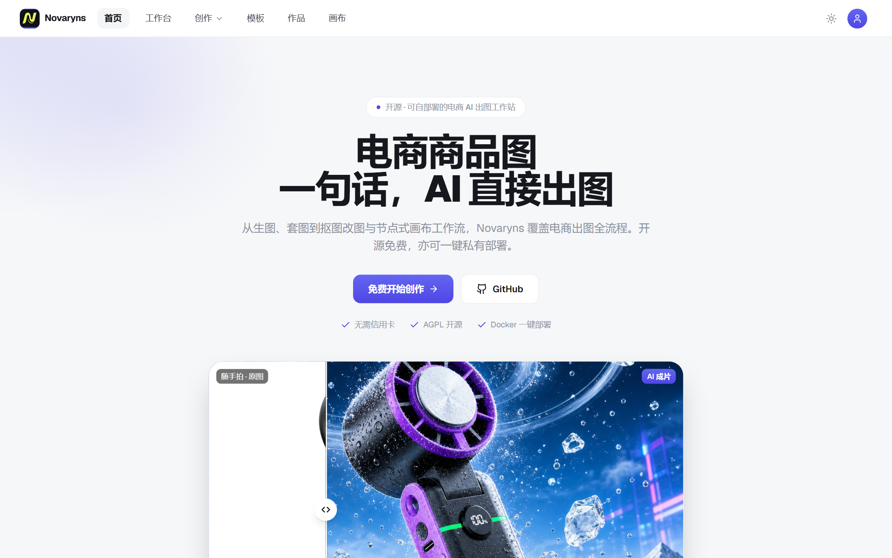
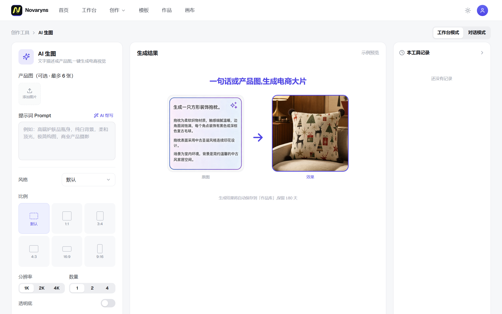
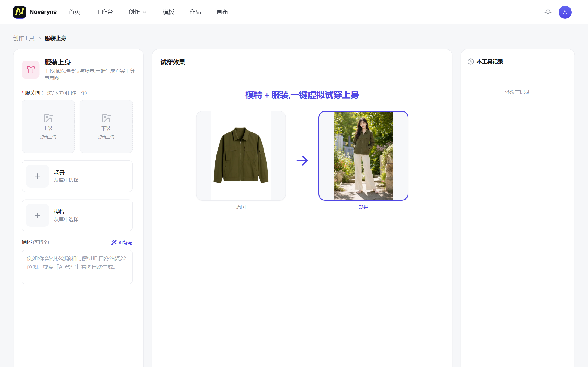

## 当前服务器约定（2026-10-13，覆盖下文历史地址与自动发布约定）

用户已明确：`120.27.162.85` **已废弃**，以后更新默认到 `103.30.76.93`。120 不再用于发布、构建、维护、探测、同步、备份任务或回滚；不因旧文档连接、重启或恢复120。此前120/香港独立运行、103验收后推广120等描述只保留为历史记录。

后续发布目标默认103，沿用目标站部署锁、备份、固定版本、权限/媒体保护及连续可用发布验收；不自动推广香港或101。原有备份与凭据不因“废弃”而删除，本记录不代表已执行停机、销毁数据、注销资源或远程状态核验。本轮只更新文档，没有连接或发布服务器。

企业版后续更新也以103为默认服务器方向，但企业版独立服务、数据库、媒体、镜像与凭据配置尚待安排；不得因此覆盖103现有Naumi实例或复用其数据/秘密，fork Actions 仍保持禁用。

<div align="center">

# Naumi

**开源 AI 电商生图网站 — 生图 / 套图 / 抠图 / 试穿 / 画布,一站式出商业级商品图**

Open-source AI e-commerce visual studio — generate, batch-suite, cut out, try on and canvas-compose production-ready product images.

[快速开始](#-快速开始--quick-start) · [功能](#-功能--features) · [技术栈](#-技术栈--stack) · [License](#-license)

</div>

---

## 新服务器预发布与交接

发布前阅读[发布手册：用户连续可用](docs/RELEASE_RUNBOOK.md)：用户已确认蓝绿切换、活动任务排空、旧前端资源保留及兼容数据库升级标准。当前为已确认待实现约定，不代表现有发布脚本已经无感；先在103验收，再按明确任务推广120。

新服务器的验收、访问入口与后续迁移约定，统一记录在 [预发布交接 README](docs/NAUMI_STAGING_MIGRATION_README.md)，最新验收与回传约定见第 20 节，公网入口见第 21 节。新机继续用于构建和测试，媒体保持本地存储；只有用户明确要求回传时才操作旧机，不将预发布数据库回灌生产。多 Agent 协作遵循 [协作说明](docs/AGENT_COLLABORATION.md)。

## ✨ 功能 / Features

- **AI 生图** — 文生图 / 图生图，支持多比例与批量生成，分辨率和质量选项按模型能力提供
- **一键套图** — 上传产品图，智能匹配或自定义主图、副图与详情页
- **图像工具** — 抠图、高清放大、局部改图、产品精修与换色、服装提取、虚拟试穿、印花提取、标题生成等
- **创作画布** — React Flow 血缘画布,每张图的来源与迭代一目了然
- **对话生图** — 聊天式改图,一句话继续迭代
- **管理后台** — 模板库、提示词、模型与供应商配置、用户及积分管理，敏感凭据加密存储
- **国际化** — 中 / 英双语,按浏览器语言自动切换

功能入口与可用模型以实例配置为准；生成和处理任务需要配置对应的模型或服务凭据。

## 🖥 界面预览 / UI

以下为界面与效果示例，实际界面以当前运行版本为准。

<p align="center">
  
</p>
<table>
  <tr>
    <td align="center" width="50%">
      <br /><b>AI 生图工作台</b>
    </td>
    <td align="center" width="50%">
      <br /><b>服装上身(虚拟试穿)</b>
    </td>
  </tr>
</table>

## 📸 功能预览 / Screenshots

<table>
  <tr>
    <td colspan="2" align="center">
      <br />
      <b>AI 生图</b> — 一句话或产品图,生成电商大片
    </td>
  </tr>
  <tr>
    <td align="center" width="50%">
       ➜ <br />
      <b>一键套图</b> — 主图、副图与详情页组合生成
    </td>
    <td align="center" width="50%">
       ➜ <br />
      <b>服装上身</b> — 选模特与场景,一键虚拟试穿
    </td>
  </tr>
  <tr>
    <td align="center">
      <br />
      <b>AI 抠图</b> — 发丝级透明底
    </td>
    <td align="center">
       ➜ <br />
      <b>AI 变清晰</b> — 模糊图高清修复放大
    </td>
  </tr>
  <tr>
    <td align="center">
       ➜ <br />
      <b>3D 服装图</b> — 幽灵模特立体展示
    </td>
    <td align="center">
       ➜ <br />
      <b>图裂变</b> — 一张图裂变整组系列素材
    </td>
  </tr>
  <tr>
    <td align="center">
       ➜ <br />
      <b>AI 融图</b> — 多图元素无缝合成
    </td>
    <td align="center">
       ➜ <br />
      <b>局部改图</b> — 涂哪改哪,其余不动
    </td>
  </tr>
</table>

## 🚀 快速开始 / Quick start

### 安装

准备 Linux 服务器以及 Git、Docker、Docker Compose v2、OpenSSL。可用以下命令检查 Docker：

```bash
docker --version
docker compose version
```

新实例可使用安装脚本：

```bash
curl -fsSL https://raw.githubusercontent.com/JesstLe/naumi/main/install.sh | bash
```

也可以先拉取仓库再执行脚本：

```bash
git clone https://github.com/JesstLe/naumi
cd naumi
bash install.sh
```

安装器会准备 `.env`、生成独立加密密钥和 Worker 密钥，尝试拉取预构建镜像；拉取失败时回退到本地构建。执行时间取决于网络和服务器资源。已有实例会沿用保存的端口，脚本也可能更新已有安装；现有服务器发布应使用下方的固定版本发布流程。

首次安装默认使用 **80 端口**；如果 80 已被其他服务占用，安装器会改用 **8080**。按安装器输出的地址访问，并在防火墙或云安全组放行对应 Web 端口。直接使用仓库的 `docker-compose.yml` 时，默认端口是 **3012**，也可通过 `.env` 中的 `HTTP_PORT` 调整。

未配置实例的首启向导提供 OpenAI API Key、管理员密码、管理员邮箱和站点名称配置。完成后进入后台配置实际使用的模型和服务凭据。

### 数据与媒体

Compose 包含 PostgreSQL、应用和视频 Worker，数据库与媒体使用持久化数据卷。图片和视频默认存储在容器的 `/data/media`。

当前 Compose 默认 `STORAGE_DRIVER=local`。切换对象存储需显式设置 `STORAGE_DRIVER=r2` 或 `STORAGE_DRIVER=s3`，并补齐对应存储配置；已有媒体的迁移另行处理。

### 模型连接

服务器无法访问模型服务时，为对应通道配置可访问的服务地址。例如，图片生成通道可在 `.env` 中配置：

```dotenv
OPENAI_BASE_URL=https://your-image-gateway.example.com/v1
```

Agent 文本 / 视觉通道使用独立的 `AGENT_BASE_URL`、`AGENT_API_KEY` 和 `AGENT_MODEL`。画布操作的管理员模型配置见 [配置说明](docs/CANVAS_ADMIN_MODEL_CONFIGURATION.md)。不同供应商和功能使用各自的配置，修改一个通道地址不会自动覆盖全部接口。

### 域名与 HTTPS

将域名指向服务器，通过 Nginx、Caddy 或宝塔面板配置反向代理与 HTTPS，代理目标使用应用实际监听的端口。Web 入口与应用端口的关系以部署配置为准。

### 源码构建与已有实例发布

本地或独立开发实例修改源码后，可执行：

```bash
docker compose up -d --build
```

运行前需要在 `.env` 配置独立的 `SETTINGS_SECRET` 和 `VIDEO_WORKER_SECRET`。已有实例须保留原加密密钥、生产配置、数据库和媒体。

现有服务器使用固定提交镜像与 `scripts/deploy-release.sh` 发布，先备份并准备回滚，再核验健康、实际版本与受影响功能。新机发布须遵循 [协作说明](docs/AGENT_COLLABORATION.md) 的全程锁与基线检查；旧机回传须用户明确要求。文档修改不触发服务器发布。

## 🧱 技术栈 / Stack

Next.js 14 (App Router) · React · TypeScript · Tailwind CSS · React Flow · PostgreSQL · OpenAI 兼容模型接口 · Replicate · 本地 / R2 / S3 兼容存储

## 📄 License

许可条款见仓库的 [LICENSE](LICENSE) 文件。

---

<div align="center">
Made with ❤️ by the <b>Naumi</b> team
</div>
