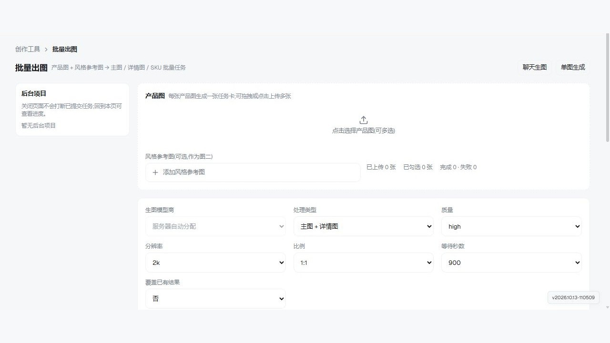

<div align="center">


# AI 电商视觉工作站

**商品生图 · 可视化画布 · 创作 Agent · 批量生产**

Self-hosted AI visual studio for e-commerce.

[部署核心](#deployment-core) · [如果你是 AI Agent](#for-ai-agents) · [如果你是人类](#for-humans) · [验收与排错](#deployment-acceptance) · [界面预览](#界面预览) · [文档](#文档)

</div>


Naumi 把商品图片、提示词、生成结果和图像工具放在同一个创作流程中。你可以直接出图，也可以在画布上连接图片与文字节点，通过 Agent 或批量任务继续处理，最后保存、复用和导出素材。

部署说明按 **2026-11-10 的 main 源码**核对；功能说明描述仓库实现，不代表每个运行实例都已部署或启用。依赖版本以 [package.json](package.json) 和锁文件为准，界面图片保留原始拍摄日期。

<a id="deployment-core"></a>

## 部署成功的核心是什么

**最关键的是模型执行配置，而不是把网页启动起来。** Naumi 不附赠模型服务或供应商额度；你需要自己的可用模型接口、真实模型 ID 和调用凭据。先跑通“登录 → 单张生图 → 作品保存 → 刷新后可见 → 积分正确”，再启用 Agent、视频、多供应商和专用工具。

| 配置模块 | 必须对齐的内容 | 缺项时的典型表现 |
|---|---|---|
| **模型与供应商** | Base URL、API Key、实际模型 ID、协议、支持的操作与参数；受管模式另需公开模型、工具范围、默认项和正式发布 | 页面正常，但无可用模型、404、参数错误或供应商拒绝 |
| **数据库与身份** | PostgreSQL、稳定的 `SETTINGS_SECRET`、首启管理员、实际使用账号 | 设置保存失败、登录失败、重启后配置读不出 |
| **任务执行** | Web 与 `video-worker` 同一镜像、数据库、密钥、模型和存储配置；Worker 实际在运行 | 能提交但一直排队；名字叫 video-worker，实际也执行图片、批量和参考任务 |
| **媒体与回读** | 持久卷、目录可写、媒体 Worker、应用可下载供应商结果 | 上游完成但保存失败，或作品刷新后图片丢失 |
| **计费与权限** | 业务报价、可用积分、账号工具权限；供应商余额另行核对 | 有模型却不能提交、积分不足或入口不可见 |

首次安装走下文的**基础模式**：一个兼容图片接口 + 内置 PostgreSQL + 本地媒体 + 默认四个 Compose 服务。**完整模型管理模式**另需独立 Router；默认 Compose 没有打包 Router、Redis、对象存储或第三方模型服务，也没有默认可用的供应商账号。基础生图不以部署这些可选服务为前提。

## 功能

| 模块 | 你可以做什么 |
|---|---|
| **AI 生图与编辑** | 输入描述或商品参考图，选择管理员发布的模型与参数；统一计划、报价和提交链路支持生成、参考图编辑、蒙版处理、批次及本地输出处理。 |
| **创作画布** | 组织图片、文字、视频和连线，使用节点 Dock、框选分组、历史选图、撤销重做与画布整理；生成过程中可继续编辑或在其他节点提交任务。 |
| **创作 Agent** | 在独立任务页或画布侧栏对话，结合当前参考素材调用创作工具，显示过程与结果，保留会话历史。 |
| **生图 Skills** | 选择商品白底、场景、套组、精修、换色、海报等精选技能；创建、导入和管理自己的创作技能。 |
| **参考工作台与套图** | `/batchshot` 进入站内参考工作台，提供批量、单图及对话式生图页面；组合产品与风格素材，查看历史和导出素材。 |
| **视频与媒体处理** | 在视频工作台或画布视频节点维护提示词、模型及图片/视频/音频引用；支持生成任务、工作流，以及提帧、裁剪、拼接和音频提取等媒体任务。 |
| **竞品工作台** | 导入参考图片或文件夹，管理素材、反推提示词、参考生图及选区编辑。 |
| **品牌包装策略** | 根据产品简报整理包装定位、创意方向和 SKU 规则；包装效果图与模切线转 3D 使用各自的工具入口。 |
| **作品与团队** | 保存作品与项目，查看任务历史、积分与用量；通过团队和子账号管理协作访问。 |
| **管理后台** | 管理模型及供应商通道、能力与参数映射、供应商元数据和成本、积分计价、模板与提示词、用户权限、品牌及服务配置。 |
| **模型健康** | 聚合已配置模型的业务成功与失败，查看通道状态；可配置独立 Worker 执行有预算的低频真实生图巡检。 |

创作工具中心分为生成创作、图像处理、服装电商和营销工具四类；当前清单来自 [工具目录](src/lib/tool-meta.ts)，账号实际可见入口受权限控制：

- **生成创作**：生图、视频、套图、参考工作台、Agent、品牌包装策略、A+ 详情页、包装模切线转 3D、参考复刻与图裂变等。
- **图像处理**：商品精修、抠图、抠头像、换色、高清放大、局部编辑、风格转换、融图和去水印。
- **服装电商**：虚拟试穿、服装提取、立体展示和去皱。
- **营销工具**：商品标题、印花提取、印刷文件与图像侵权风险辅助筛查。

工具入口不等于供应商已经配置或每项效果都已验收。实际模型能力、可用参数、计费和视频可用性以实例配置为准；侵权筛查是辅助信息，不是法律结论。

### 工作流与执行边界

- **计划与实际执行**：图像任务先核对素材归属、模型能力和参数，再冻结报价与执行配置；预览计划不等于提交生成。缺少已核实能力的通道不会因目录中出现同名模型而自动放行。
- **参考图与画幅**：自动比例按明确的参考/编辑目标角色解析，多参考歧义时要求用户选择；已接受任务不随新默认值重解释。图像生成路径保留返回画幅，不因比例参数默认裁切；显式像素输出采用完整画面适配，不保证供应商返回精确尺寸。
- **画布入口**：沿用图片节点 Dock 及现有工具操作，不再增加一套重复的“图像创作”悬浮面板；共享图像后端仍服务画布、Agent 和参考工作台。
- **跨画布迁移**：支持识别稿定剪贴板工作流中的兼容元素并导入；素材原链接失效时保留元数据占位，可后续补图。不是任意第三方格式的无损转换。
- **任务与积分**：生成、批量和 Agent 工具接入任务及计费流程；离开页面不代表取消已提交任务，操作前应核对实际报价。
- **服务端 Harness**：Agent 执行经过会话与资源归属、工具能力、输入参数、报价确认和出站网络边界检查；参考图、历史和技能文本不作为授权来源。它是分层防护，不是“绝对防注入”的保证。
- **加载与缓存**：图片展示路径使用账号隔离的 IndexedDB 图片字节缓存，并保留按需加载和会话失效处理；本地命中不代替服务端授权，也不等于永久离线副本。
- **视频能力**：生成协议、引用类型和参数由具体模型决定；本地媒体处理需要独立媒体 Worker。工具入口、模拟测试或镜像内含 FFmpeg，不等于某实例的视频供应商已验收。

## 界面预览

下图均为 **2026-10-13 实际界面截图**，不是概念效果图或当前版本截图。拍摄实例版本为 `2026.10.13-110509`；后续节点 Dock、视频与工具入口已有变化，旧工具中心图片中的 27 项不代表当前目录。模型名称、价格和内容属于拍摄实例配置，不代表默认值。图片来源和裁切记录见 [截图说明](docs/README_MEDIA.md)。

<table>
  <tr>
    <td width="50%" valign="top">
      
      <br /><b>商品生图</b><br />参考图、描述与模型参数集中配置。
    </td>
    <td width="50%" valign="top">
      
      <br /><b>服装试穿</b><br />选择服装、模特和场景，查看处理结果。
    </td>
  </tr>
  <tr>
    <td width="50%" valign="top">
      
      <br /><b>创作 Skills</b><br />把常用创作方法保存为可复用技能。
    </td>
    <td width="50%" valign="top">
      
      <br /><b>批量工作台</b><br />用统一设置提交多个商品任务。
    </td>
  </tr>
</table>

<details>
<summary><b>查看工具中心与首页</b></summary>

### 创作工具中心


### 站点首页


</details>

截图中的工具效果是页面已有示例，画布采用已有验收项目；本次截图没有新提交付费生成，也不构成对全部供应商或工具效果的重新验收。

## 快速开始

两条路径使用相同的配置与验收标准：AI Agent 按执行契约操作，人类按编号步骤操作。这里的 AI Agent 是**帮你部署的软件助手**，不是 Naumi 产品里的创作 Agent。

<a id="for-ai-agents"></a>

### 如果你是 AI Agent

1. **先识别新装还是升级。** 阅读 `AGENTS.md`、本 README、`docker-compose.yml`、`Dockerfile` 和 `.env.example`，记录 Git SHA、端口与现有实例。新装使用独立目录与数据卷；既有实例走[更新流程](#现有实例更新)，保留原密钥、数据、媒体和任务状态。
2. **收集真实配置，不猜默认值。** 需要目标环境、访问地址、管理员邮箱、图片接口 Base URL、真实图片模型 ID、该模型支持的协议/参数，以及通过秘密输入渠道提供的 API Key、管理员密码。缺失项列为 `PENDING`；示例值不是可用配置。先选基础模式；只有用户已有兼容 Router 时才进入受管模式。
3. **执行下方人类路径的 1—3 步。** 生成独立随机密钥，数据库密码与 DSN 同步，首次 `OPENAI_API_KEY` 留空；固定源码构建并记录 App/Worker 的镜像 ID。只写环境文件还不够，必须核对 Compose 实际注入的变量及 Worker 版本。
4. **完成首启，而不只检测首页。** 浏览器访问 `/setup`；自动化可在首次未配置实例调用 `POST /api/setup`，`Content-Type: application/json`，字段为 `apiKey`、`siteName`、`adminEmail`、`adminPassword`。提交真实密钥和管理员信息但不输出到日志。成功为 `200 {"ok":true}`；`403` 表示实例已锁定，先核对现有管理员/环境，不覆盖数据或循环提交。向导不校验供应商实际可用性，也不接收 Base URL 或模型 ID；这两项在环境或后台设置。
5. **完成模型、钱包与权限配置。** 基础模式使用 `/admin?view=settings` 的“接口与模型”；受管模式按[完整模型管理](#managed-models)保存并发布，保留发布版本与操作编号。Agent 对话、图片生成、视频生成是不同能力，不把同一个模型 ID 自动填到所有通道。
6. **按验收清单逐项收证。** 先做不产生模型费用的基础检查，再在明确的测试预算内提交一张图。记录任务 ID、终态、作品/媒体回读、刷新恢复、账务与预占；超时或受理未知保留原任务查询，不重新购买。对话和各可选工具分别验收。
7. **交付可复核结果。** 输出访问地址、源码/镜像版本、配置来源（不含秘密）、每项 `PASS / FAIL / PENDING`、故障点和回滚引用。只有页面打开时写“Web 已就绪”，只有真实出图与保存回读通过时才写“基础生图已验收”。

可复制给部署助手的提示词：

```text
请部署当前 Naumi 仓库，并以 README 的“部署验收”作为完成标准。
先读 AGENTS.md、README、Dockerfile、docker-compose.yml 和 .env.example，
区分新装与已有实例；默认先跑通基础图片模式，不假设已部署 Router。
从我提供的配置取得真实图片接口、模型 ID、凭据和管理员信息；秘密通过
受保护输入/文件处理，不回显、不提交 Git，不用占位值伪装成功。
新装生成三个独立密钥，保持 PostgreSQL 密码与 DATABASE_URL 一致；
首启前 OPENAI_API_KEY 留空，通过 /setup 同时初始化 Key 和管理员。
构建传入完整 SOURCE_COMMIT，确认 Web、video-worker、media-worker 同镜像，
核对数据库、Worker、媒体可写与回读，再配置模型、余额及工具权限。
先验证基础检查；经确认的预算内只提交一张真实图，核对任务、作品、
刷新恢复及积分。遇到超时或 UNKNOWN 继续查原任务，不重复提交。
最后交付 URL、版本、脱敏配置来源和逐项 PASS/FAIL/PENDING；
未做真实供应商调用时明确将“真实出图”保留 PENDING，不把 health 200 当验收。
```

<a id="for-humans"></a>

### 如果你是人类

#### 1. 准备环境和模型资料

推荐 Linux + Docker Engine + 支持 `docker compose` 的 Compose v2 或更高版本，另需 Git、OpenSSL。Windows 可在 WSL2 的 Linux 环境执行以下 Bash 命令；它们不是 PowerShell 语法。源码构建还需访问 npm 与系统软件源。

- 准备一个**支持 OpenAI Images 兼容协议**的图片服务：确认 Base URL、API Key、可调用的真实模型 ID、文生图支持的质量/尺寸和账户余额。只有 Chat Completions 或视频接口的 Key 不代表支持图片接口。
- 预留构建和运行空间。建议起步资源为 **4 vCPU / 8 GiB RAM / 20 GiB 可用磁盘**，这是安装建议而非容量承诺；媒体 Worker 在默认 Compose 中的上限为 3 GiB / 2 CPU，构建峰值和并发需要额外实测。
- 首启在 localhost、SSH 隧道或受限访问入口完成，创建管理员后再开放站点。远程输入密码和 API Key 使用 HTTPS 或隧道。只开放 Web 入口；数据库和内部 Worker 留在内部网络。

```bash
git clone https://github.com/JesstLe/naumi.git
cd naumi
git rev-parse HEAD
docker version
docker compose version
```

#### 2. 创建新实例环境文件

**以下命令只用于全新目录**，已有 `.env` 时会退出；不要用它覆盖既有配置。Compose 读取仓库根目录 `.env`，不是 `.env.local`。

```bash
set -eu
test ! -e .env || { echo 'STOP: .env already exists'; exit 1; }
umask 077
DB_PASSWORD="$(openssl rand -hex 24)"
cat > .env <<EOF
COMPOSE_PROJECT_NAME=naumi-$(openssl rand -hex 4)
HTTP_PORT=3012
POSTGRES_USER=naumi
POSTGRES_DB=naumi
POSTGRES_PASSWORD=${DB_PASSWORD}
DATABASE_URL=postgres://naumi:${DB_PASSWORD}@db:5432/naumi?sslmode=disable
SETTINGS_SECRET=$(openssl rand -hex 32)
VIDEO_WORKER_SECRET=$(openssl rand -hex 32)
MEDIA_WORKER_SECRET=$(openssl rand -hex 32)
STORAGE_DRIVER=local
NAUMI_PUBLIC_COMMERCE=0
OPENAI_BASE_URL=
OPENAI_IMAGE_MODEL=
OPENAI_API_KEY=
EOF
unset DB_PASSWORD
```

生成的 `COMPOSE_PROJECT_NAME` 标识本实例的数据卷，后续更新保持原值；同一主机安装多个实例时，各自使用独立目录、项目名和 Web 端口。

启动前用编辑器补全两项：

- `OPENAI_BASE_URL`：图片服务的兼容 API 基址，例如 `https://your-provider.example/v1`。这个域名只是格式示例；不要填网站首页、控制台地址或完整的 `/images/generations` 路径。
- `OPENAI_IMAGE_MODEL`：该 Key 实际有权限调用的模型 ID，不是自取的展示名。留空时 Compose 使用代码默认值，默认名称不保证你的供应商提供。

**首次保持 `OPENAI_API_KEY` 为空，在下一步向导中填写。** 当前首启逻辑检测到环境/数据库中已有图片 API Key 或管理员密码，就视为“已配置”。提前填 Key 可能跳过管理员创建。三个密钥分别生成、分别保留；设置加密密钥需要随备份保存，既有实例换值须走密文迁移。

`POSTGRES_PASSWORD` 与 `DATABASE_URL` 必须同步修改。上例用十六进制密码避免 DSN 转义问题；自行设置含特殊字符的密码时做 URL 编码。数据库已有卷时，修改 `POSTGRES_PASSWORD` 不会替你修改库内角色密码。

#### 3. 构建并启动同一版本的四个服务

这里选择**从当前源码构建**，避免 `latest` 镜像与本文所读源码不一致。宿主机无需单独安装 Node.js；Dockerfile 使用 Node.js 24。

```bash
docker compose config --quiet
docker compose pull db
docker compose build \
  --build-arg SOURCE_COMMIT="$(git rev-parse HEAD)" \
  --build-arg BUILD_VERSION="$(date +%s)" app
docker compose up -d --no-build --pull never
docker compose ps
docker compose images
```

`app` 的构建产物同时供 `video-worker`、`media-worker` 使用。**不要省略 `SOURCE_COMMIT`**：默认 Compose 开启持久化 direct Worker，空提交标识会触发 `DURABLE_WORKER_CONTROL_CONFIG_REQUIRED` 并退出。仅设置宿主机同名变量不等于传入 Docker 构建参数。

等待 `db`、`app`、`media-worker` 健康，`video-worker` 保持运行；后者没有 Compose healthcheck，仍需执行下方的 Worker 状态检查。访问 `http://localhost:3012/setup`（远程改成你的入口）；端口用 `.env` 中的 `HTTP_PORT` 调整。

仓库保留 `install.sh`，但它会探测已有安装、更新目录、选择镜像源和端口；默认 80，占用时 8080。它不是在线蓝绿发布工具，也不替代模型/账务验收。本指南不把安装器的“已启动”输出作为成功标准，首次安装优先使用上面的可核对步骤。

#### 4. 创建管理员，再配置图片通道

1. `/setup` 填写真实图片 API Key、站点名称、管理员邮箱和管理员密码。UI 要求密码至少 6 位，实际请使用长随机密码；填写邮箱后可用邮箱/密码登录。保存后确认 `/admin` 能进入，并验证普通站点登录。
2. 手动进入 `/admin?view=settings`，打开“接口与模型”，确认接口地址、默认生图模型和允许选择的模型。基础模式中，**后台保存值优先，环境变量兜底**；以后只改 `.env` 不会覆盖已保存的数据库配置。
3. 先仅开放一个已确认支持文生图的模型，使用该服务支持的一组参数。不把 `/v1/models` 返回某个 ID 当作出图成功，也不直接照抄其他实例的 4K、high、参考图或蒙版能力。

首启向导只保存 Key、站点与管理员信息，不负责验证模型，也不完成所有工具绑定。若系统已启用受管模式，旧“接口与模型”编辑会让位于模型配置中心，转到下文[完整模型管理](#managed-models)。

#### 5. 确认实际使用账号的积分和权限

- 用准备验收的账号登录。后台“用户管理”(`/admin/center?section=users`)核对其可用积分；不足时通过后台调整积分。不要把管理员角色等同于无限余额，也不要假定某个历史赠送数一直有效。
- 后台“套餐与账务”(`/admin/billing`)核对当前功能的报价；受管模型可在模型管理中设置积分售价。**上游账户余额和 Naumi 用户积分是两套账**，两边都要满足请求。
- `/admin/feature-access` 核对工具权限。`NAUMI_PUBLIC_COMMERCE=0` 只隐藏公开购买/充值入口，不等于关闭积分校验或把供应商调用变免费。

完成后按[部署验收](#deployment-acceptance)跑通一张图，再增加其他能力。

## 配置

环境变量参考 [.env.example](.env.example)，**实际容器注入以 [docker-compose.yml](docker-compose.yml) 为准**；模板中的历史说明不代表全部依赖已自动配置。`.env` 主要供 Compose 插值；`.env.local` 供本地 Next.js 使用。终端已导出的同名变量优先于 `.env`，应先核对是否残留其他实例的配置。新增一个未被 Compose 引用的字段，不会自动进入容器。执行任务的 App 与 direct Worker 要同时接入相同业务配置，不能只改 Web。

| 配置项 | 用途 |
|---|---|
| `DATABASE_URL` / `POSTGRES_*` | PostgreSQL 业务数据库；Compose 内默认主机是 `db`，不是宿主机的 localhost。应用在启动阶段初始化所属 schema，数据库角色须有对应建表/迁移权限。 |
| `SETTINGS_SECRET` | 会话签名与敏感设置加密；既有实例保持原值，轮换必须迁移已有密文。 |
| `VIDEO_WORKER_SECRET` | 应用与独立 Worker 的内部鉴权。 |
| `MEDIA_WORKER_SECRET` / `MEDIA_WORKER_ORIGIN` | 媒体任务服务的独立鉴权和内部入口；密钥不复用设置或视频 Worker 密钥。 |
| `SOURCE_COMMIT` | 镜像构建参数与运行身份；受控 Worker 必须非空，使用完整源码 SHA。 |
| `NAUMI_APPLICATION_TASK_EXECUTION` | 默认 Compose 为 `worker`，Web 持久化任务，direct Worker 执行；仅启动 Web 不构成完整部署。 |
| `OPENAI_BASE_URL` / `OPENAI_API_KEY` / `OPENAI_IMAGE_MODEL` | 基础图片通道的地址、凭据、真实模型 ID；Key 在首启向导填写，后台配置优先。 |
| `AGENT_BASE_URL` / `AGENT_API_KEY` / `AGENT_MODEL` / `AGENT_VISION_MODEL` | 文本/视觉通道；使用时逐项明确配置并单独验收，不认为图片接口可自动完成对话与识图。 |
| `AGENT_BACKEND` | Agent 桥接实现，默认 `pi`；其他后端需各自接入与验收。 |
| `VIDEO_API_*` / `VIDEO_PROVIDERS_JSON` | 视频供应商与模型配置；实际支持的引用、时长和参数按模型能力核验。 |
| `MODEL_HEALTH_WORKER_SECRET` | 应用与可选健康 Worker 的独立鉴权；默认 Compose 不自动启动该 Worker。 |
| `STORAGE_DRIVER` | 首次保持 `local`。`s3` / `r2` 需完整的存储端点、桶、凭据和访问策略。 |
| `MEDIA_PRIVATE` / `R2_*` | 默认 Compose 未显式注入这些字段；使用前扩展 App 和 Worker 的 environment，并核验读写与媒体访问。 |
| `HTTP_PORT` | Compose 对外应用端口；公网入口可由反向代理统一承接。 |
| `NAUMI_PUBLIC_COMMERCE` | 公开购买、充值及价格入口，按实例运营需求设置。 |

修改环境后，新装验收环境重新执行 `docker compose up -d --no-build --pull never` 才会重建使用新配置的容器，`docker compose restart` 不会重新注入环境。已有在线实例仍按发布手册蓝绿更新。不要公开粘贴 `docker compose config` 的完整输出，里面可能包含展开后的密码；语法检查使用 `--quiet`。

<a id="managed-models"></a>

### 完整模型管理：供应商 → 模型 → 工具 → 计费 → 发布

多供应商、公开模型名称、参数映射和按工具分配模型使用这一模式。**前置条件是兼容的独立 Router 管理服务；默认四服务 Compose 不包含它。** 这是额外的部署依赖，不是把某个公开模型 API URL 填进 Router 地址即可替代。没有该服务时先使用基础模式，不填写虚构的 `NAUMI_ROUTER_MANAGEMENT_URL`。

1. **连接管理服务。** App 与 Worker 配置 `NAUMI_ROUTER_MANAGEMENT_URL`、`NAUMI_ROUTER_MANAGEMENT_TOKEN`、`MODEL_CONFIG_ENVELOPE_SECRET`，Router 端保持相应令牌/加密契约一致。令牌和 envelope secret 分别使用独立的 32 字符以上随机值。需要受管内网地址时按实际服务设置精确的 `MODEL_CONFIG_TRUSTED_ORIGINS`。模型池等经 Router 执行的路径还需 `NAUMI_ROUTER_GENERATION_URL` / `NAUMI_ROUTER_GENERATION_TOKEN`；采购回执集成另核对 `NAUMI_ROUTER_COST_*`。详见[管理连接与协议](docs/model-configuration.md)。
2. **接入供应商。** 在 `/admin/model-management` 的上游来源维护名称、Base URL、协议和凭据；协议按实际接口选择，不能将“兼容 OpenAI”直接等同于所有图片/文字/视频协议。凭据保存到加密凭据库。
3. **登记上游模型。** 从目录发现或按已知 ID 添加，核对类型、generate/edit/vision 能力、参考图数、质量、分辨率等。供应商目录、当前 Key 可访问的模型和真实调用结果是三种证据；目录可见不表示参数全部可用。资料入口是 `/admin/model-management/library`。
4. **设置前台模型和工具范围。** 建立启用且可见的公开模型，指向已启用上游或模型池，设置“编辑范围”和默认项。先绑定 `image.generate`；画布再核对 `canvas.image`、编辑与文字能力，视频单独核对 `video.generate`。单有供应商或上游模型，用户不一定能选到它。
5. **设置参数与价格。** 前台选择、管理员参数映射、实际发送值和实际输出分别核对；显式“不发送”、`false`、`0` 保留语义。客户积分售价与供应商货币成本分别配置，不能互相代替。成本策略要求的能力、成本项需完整。
6. **保存、校验、发布。** 通过 `/admin/bi/models` 的完整配置或模型管理动作完成发布，记录生效的模型版本、计费版本。保存草稿不等于已生效；发布结果 `unknown` 时按原操作编号核对，不新建发布绕过。管理员已发布映射优先，供应商资料刷新不自动覆盖。
7. **用实际入口复查。** `GET /api/models?feature=image.generate` 在受管模式应返回 `managed:true`、可用模型与当前版本；基础模式返回 `managed:false` 和空的受管目录是正常现象，不应据此判定未配置图片服务。最终仍以实际任务验收为准。

完整配置已经发布后，只删除 Router 环境变量不会把实例自动退回基础模式；已发布配置和历史任务继续使用冻结上下文。详见[模型管理操作](docs/admin-model-management.md)、[工具绑定](src/lib/model-config/feature-model-policy.ts)和[供应商资料](docs/supplier-model-metadata.md)。

### 按需启用其他能力

| 能力 | 在基础生图之外还要做什么 |
|---|---|
| 创作 Agent / 文字 / 图片理解 | 配置真实文本/视觉模型及其通道，核对 tool calling、流式响应、图像输入支持；受管模式发布对应文字/视觉绑定。分别测试纯文本、带图理解、调用生图工具，成功一项不代表其他项成功。 |
| 视频生成 | 配置支持目标视频协议的供应商、模型及参考类型/时长等参数，核对 video-worker 和媒体 Worker；媒体处理可用不代表供应商视频生成可用。 |
| OCR、抠图、高清放大 | 按所选实现补齐 PaddleOCR、视觉模型或 Replicate 等专用服务。`REPLICATE_API_TOKEN` 等非默认注入项需在 Compose 中显式传给实际执行服务。 |
| R2 / S3 / NAS | 本地媒体验收后再接存储，核对写入、读取、签名/代理、历史文件迁移；NAS 通过经验证的 S3 兼容接口接入。 |
| 健康巡检 | 另启健康 Worker 与独立密钥，确认真实调用预算；不作为首次生图必装项。 |

### 通道与模型健康

管理入口为 `/admin/model-health`。只检查当前发布配置中的启用模型，不遍历供应商完整目录；供应商通道状态由其已配置模型聚合。

- 默认策略：最近 **6 小时**有成功业务生图则跳过主动探测；否则到期模型每次生成 **1 张**，全系统按上海自然日合计最多 **12 次**。
- 成功生图需实际下载并解码图片，不把 HTTP200、目录可见或账本阶段标签当作完整成功证据。失败、超时或受理未知均保留相应状态，未知请求不自动重发。
- 主动巡检可能产生供应商费用，进入系统供应商成本账，不扣用户积分；不会自动改写管理员的通道权重或启停设置。文字/视频等未主动适配的协议不凭名称套用生图探测。
- 独立入口为 `node scripts/model-health-worker.mjs`，Compose 扩展见 [健康 Worker 配置](deploy/model-health-worker.compose.yml)。需要为 App 和该 Worker 注入相同的独立密钥并按部署流程启动；页面有策略不代表调度已经运行。

### 数据与媒体

- 默认 Compose 包含 `db`、`app`、`video-worker`、`media-worker` 四个服务：`pgdata` 保存数据库，`appdata` 挂载 `/data`（业务媒体在 `/data/media`），`mediajobs` 在 App 与媒体 Worker 间共享 `/scratch`。
- `media-worker` 使用镜像内的 FFmpeg/FFprobe 和隔离媒体运行环境，不开放宿主机端口；默认资源上限与权限配置见 Compose。浏览器不能用 Web 登录替代该内部服务鉴权。
- 默认 Compose 使用本地媒体。代码支持 R2 和 S3 兼容存储；切换时需要配置、访问权限和历史媒体迁移，不能只改驱动后丢掉旧路径。
- 私有媒体的签名读取、直传和缩略能力取决于实际实例的网关与存储配置，不把某个测试站配置当作默认安装结果。
- 备份需同时保留数据库、媒体、运行配置和加密密钥；更新代码不以旧数据库覆盖当前业务数据。

### 品牌与入口

后台可配置运行时站点名称与 Logo；部分 favicon、画布标识及 `NEXT_PUBLIC_*` 变量在构建期生效。域名和 HTTPS 通过实际部署的反向代理配置，不在 README 固定第三方服务地址。

<a id="deployment-acceptance"></a>

## 部署验收与排错

### 先检查基础服务，不调用模型

在仓库目录执行：

```bash
docker compose ps
docker compose exec -T app node -e 'fetch("http://127.0.0.1:3000/api/health").then(async r=>{const j=await r.json();const ok=r.ok&&j.product==="Naumi"&&j.db?.enabled===true&&j.db?.ok===true;console.log(JSON.stringify({ok,product:j.product,db:{enabled:j.db?.enabled,ok:j.db?.ok},openai:j.openai}));process.exit(ok?0:1)}).catch(()=>process.exit(1))'
docker compose exec -T video-worker node -e 'fetch("http://127.0.0.1:3001/status",{headers:{"x-video-worker-secret":process.env.VIDEO_WORKER_SECRET}}).then(async r=>{const s=await r.json();const ok=!!(r.ok&&s.executionMode==="direct"&&s.durableControl===true&&s.commit&&s.commit===process.env.SOURCE_COMMIT&&s.paused===false&&s.unresolvedTicks===0&&["IDLE","RUNNING"].includes(s.phase));console.log(JSON.stringify({ok,phase:s.phase,commit:s.commit}));process.exit(ok?0:1)}).catch(()=>process.exit(1))'
docker compose exec -T media-worker node -e 'fetch("http://127.0.0.1:3001/health",{headers:{authorization:"Bearer "+process.env.MEDIA_WORKER_SECRET}}).then(async r=>{const s=await r.json();const ok=!!(r.ok&&s.ok===true&&s.sandbox===true&&s.draining===false&&s.version&&s.version===process.env.SOURCE_COMMIT);console.log("media_worker_status="+r.status+" ready="+ok);process.exit(ok?0:1)}).catch(()=>process.exit(1))'
```

预期：两个 JSON 检查均 `ok:true`，媒体检查 `media_worker_status=200 ready=true`，命令 exit 0。`/api/health` 即使 HTTP 200 也可能 `db.ok=false`；`openai.enabled` 只表示读取到了 Key，不会替你请求供应商。当前 local 模式的 `storage.enabled` 也会为 true，它表示驱动已配置，不会实际测试目录写入或媒体回读。

### 再完成一条真实业务闭环

- [ ] `/setup` 已完成；管理员和实际使用账号登录成功，重载后仍可登录。
- [ ] 生图页能选择实际模型；该账号有工具权限、可用积分，供应商账户有额度。
- [ ] 以明确预算提交**一张**图片，记录原任务 ID，任务从受理进入成功终态。
- [ ] 结果在作品/画布显示，原图可打开或下载；刷新页面后同一作品和媒体仍可读取，不只依赖浏览器缓存。
- [ ] 积分按该次报价结算一次，预占释放；失败或未知任务的退款/核对状态有记录。
- [ ] 首次开放用户前，在没有活动任务的新装验收环境重启服务，再确认管理员配置、作品和媒体保留。已有用户实例使用发布流程验证，不直接重启在线槽。
- [ ] 新启用的 Agent、视频、编辑、蒙版或专用处理器分别通过其代表性操作；未测试项写 `PENDING`。

README 命令校验、容器启动、模拟供应商测试与真实生图是不同证据。本指南的源码/文档核验记录见[本次更新记录](docs/changes/2026-11-10-readme-onboarding.md)；每个部署者仍需在自己的网络、供应商账号和存储上完成以上验收。

### 按症状定位

先在本机查看 `docker compose logs --tail=100 app video-worker media-worker`，分享前脱敏；不要用删除数据库卷、重新生成秘密或重发未知任务排错。

| 症状 | 优先核对 |
|---|---|
| Compose 提示缺密钥 | 根目录 `.env` 的三个独立密钥、当前工作目录和 `docker compose config --quiet`。 |
| 数据库健康失败 / password authentication failed | `DATABASE_URL` 是否与 `POSTGRES_*` 一致；容器内主机应为 `db`；旧卷的库内密码、数据库权限、启动日志。 |
| 首次没有向导 / setup 返回 403 | 环境 Key 或数据库管理员密码是否已让实例锁定。只有确认是从未初始化的新实例，才清空误填的环境 Key 并重建容器；已有实例从管理员入口维护。 |
| 网页正常，任务一直排队 | `video-worker` 是否退出/暂停/UNKNOWN、`SOURCE_COMMIT` 是否为空、`dist/worker/application.cjs` 是否在镜像内；Web/Worker 的 DB、密钥、镜像及任务模式是否一致。 |
| 设置已保存，但模型无效 | 基础模式检查后台值是否覆盖 env；受管模式检查生效版本、公开模型可见性、供应商/上游启用状态、工具范围与默认项；草稿尚未发布不生效。 |
| Router 不可用 | 是否误给基础模式配置了 Router URL；完整模式检查独立 Router 服务、内部网络、管理令牌/envelope secret，及需要时的生成连接。 |
| 401/403、404、model not found、参数错误 | 图片服务的真实 Key 权限、API 基址、协议、真实模型 ID 和当前模型支持的参数；不要靠重复试不同模型名来验证。 |
| 连接超时、TLS/DNS 失败 | 从实际执行容器检查模型 API 和返回媒体域名的网络；浏览器能访问不代表服务器可访问。国内部署尤其要准备服务器可达的兼容接口。 |
| 提示积分不足 / 工具不可见 | 当前登录的真实账号、钱包可用余额/预占、功能权限、模型工具范围和供应商余额分别检查。 |
| 供应商完成但无图 / 刷新后丢图 | `/data/media`、`appdata` 持久卷、结果下载错误、媒体 Worker、对象存储读写和媒体鉴权；保留原任务 ID 查恢复状态。 |
| 改了 `.env` 仍无变化 | 字段是否在 Compose 的 environment 中，App 与 Worker 是否同步重建，是否被后台已发布配置覆盖；`NEXT_PUBLIC_*` 需要重新构建。 |

### 本地开发

本地安装 **Node.js 24**，准备独立 PostgreSQL 16 数据库（角色具有 schema 初始化权限），不要指向生产数据库。

```bash
npm ci
cp .env.example .env.local
# 编辑后再启动：见下面必填清单。
npm run dev
```

`.env.local` 至少设置有效 `DATABASE_URL`、独立随机的 `SETTINGS_SECRET` / `VIDEO_WORKER_SECRET` / `MEDIA_WORKER_SECRET`，以及 `NAUMI_MULTI_USER=1`、实际 `OPENAI_BASE_URL` / `OPENAI_IMAGE_MODEL`；首次 `OPENAI_API_KEY` 留空并走 `/setup`。本机数据库地址用实际监听的 `127.0.0.1:<端口>`，不要照搬 Compose 的 `db` 主机名。

默认 `http://localhost:3000`。不设置 `NAUMI_APPLICATION_TASK_EXECUTION` 时单进程开发沿用 `local` 执行；不要只复制 Compose 的 `worker` 开关却不启动 Worker。验证独立任务恢复、媒体处理及部署拓扑时使用上面的完整 Compose 栈。`npm ci` 的 postinstall 会应用框架请求体修补，predev/prebuild 会构建参考工作台静态资源；不要跳过脚本。Windows PowerShell 复制文件用 `Copy-Item .env.example .env.local`。

## 开发与发布

### 技术栈

Next.js **15.5.x** App Router · React **19.3.0** · Node.js **24** · TypeScript · Tailwind CSS 3 · React Flow 12（`@xyflow/react`）· PostgreSQL · Sharp · FFmpeg/FFprobe · OpenAI 兼容接口 · 本地 / R2 / S3 兼容存储

仓库还提供普通、桌面与企业界面的独立构建参数；`NEXT_PUBLIC_*` 和界面构建参数不能仅靠容器运行时改值替代重新构建。

```text
src/app/                 页面与 API 路由
src/components/          画布、工具工作台与后台组件
src/lib/agent/           Agent 桥接、工具与 Harness
src/lib/image-skills/    创作 Skills
src/lib/imagegen/        统一图像计划、执行、编辑与批次
src/lib/model-config/    模型配置与执行映射
src/lib/model-health/    业务健康观察与有预算巡检
src/lib/supplier-models/ 供应商目录、资料与实测证据
src/lib/billing/         积分与计费
src/lib/canvas/          画布数据与工作流支持
src/lib/video/           视频生成、媒体任务与工作流
src/lib/reference-workbench/ 站内参考工作台桥接
src/lib/object-storage/  本地与对象存储适配
src/lib/release-runtime/ 发布期间的任务与运行状态
services/reference-workbench/ 参考工作台页面与独立服务源码
scripts/                 Worker、验证与发布工具
deploy/                  可选服务的部署配置
docs/                    实现、交接与验收记录
```

### 协作与验证

从独立 `codex/` 分支/worktree 开工，刷新远端 main，保护他人未提交内容，选择性提交。按模块完成开发后集中测试；每累计三次功能迭代整合一次远端 main。详见 [协作说明](docs/AGENT_COLLABORATION.md) 与 [AGENTS.md](AGENTS.md)。

```bash
npm run build
# 按本轮改动选择对应验证，不把下面列表当作全部功能验收。
npm run verify:image-skills
npm run verify:imagegen-contract
npm run verify:imagegen-capabilities
npm run verify:worker-handoff
```

模型配置、元数据、计费和任务等数据库回归需使用隔离 PostgreSQL，按对应脚本要求设置 `NAUMI_VERIFY_ISOLATED_DB=1` 与 loopback `DATABASE_URL`；浏览器回归还需相应 fixture 服务。不要把所有 `verify:*` 当作无需前置条件即可执行的命令，也不要指向正在使用的业务库。

### 现有实例更新

发布目标按 [AGENTS.md](AGENTS.md) 和本次任务的最新约定确认；各站点保持独立，不把历史文档中的地址当作当前默认连接或跨站发布指令。

发布前阅读 [连续可用发布手册](docs/RELEASE_RUNBOOK.md) 与 [发布生命周期](docs/RELEASE_LIFECYCLE.md)：固定版本、整合同事已完成提交、目标站全程部署锁、备份与回滚、新槽真实就绪、旧客户端兼容和受影响功能验收。

仓库已包含生命周期状态机、任务/Agent 活动观察、Worker 持久化交接及旧资源退役门禁；**这些实现不等于所有站点已完成无感发布或旧槽排空**。未完成、未知或回滚失败状态需要保留并核对；不能用健康检查通过代替真实任务、会话、租约和恢复链路证据，也不能绕过门禁原地重建在线槽位。

已有服务不应先停旧 App 再等待构建；跨站数据合并、存储迁移和破坏性 DDL 分开安排。源代码更新不自动迁移数据库、媒体或秘密。

GitHub [镜像工作流](.github/workflows/docker.yml) 可按固定源码生成候选镜像及可选离线包；构建或推送镜像不自动代表服务器切流。本文没有实时探测线上版本，实例交付状态应查看对应发布记录并重新核验。

## 文档

| 主题 | 入口 |
|---|---|
| 画布与工作流 | [画布状态](docs/CANVAS_STATUS.md) · [工作流集成](docs/CANVAS_WORKFLOW_INTEGRATION.md) |
| Agent 与防护 | [Agent](docs/agent.md) · [Harness 交付记录](docs/changes/2026-10-13-agent-harness-release.md) |
| 模型与供应商 | [模型管理](docs/admin-model-management.md) · [供应商模型资料](docs/supplier-model-metadata.md) |
| 健康与能力证据 | [模型健康模块](docs/changes/2026-10-15-model-health.md) · [实测能力入库](docs/changes/2026-10-15-banana-edit-metadatabase.md) |
| 图像计划与画幅 | [参考图画幅规则](docs/changes/2026-10-17-imagegen-generation-reference.md) · [重复面板移除](docs/changes/2026-10-17-imagegen-panel-removal.md) |
| 视频与媒体任务 | [视频子系统](docs/VIDEO_SUBSYSTEM_REWRITE_PLAN.md) · [视频节点 Dock](docs/changes/2026-10-16-canvas-video-dock.md) |
| 计费与积分 | [计费入口](docs/billing-entrypoints.md) · [计价服务](docs/pricing-service.md) |
| 图片与展示 | [历史截图来源](docs/README_MEDIA.md) · [历史功能核对](docs/changes/2026-10-17-readme-refresh.md) |
| 首次部署 | [AI 与人类双路径更新记录](docs/changes/2026-11-10-readme-onboarding.md) |
| 部署与接手 | [发布手册](docs/RELEASE_RUNBOOK.md) · [生命周期门禁](docs/RELEASE_LIFECYCLE.md) · [协作说明](docs/AGENT_COLLABORATION.md) |
| 用户更新说明 | [公开更新目录维护](docs/PUBLIC_RELEASE_NOTES.md) |
| 项目学习与面试 | [分级面试手册](docs/interview-handbook/README.md) |

历史实现文档与运行环境可能不同；冲突时按最新用户指令、当前源码和实际配置核对，不用旧验收替代新版本验收。

## License

本仓库保留 **GNU AGPL-3.0**，完整条款见 [LICENSE](LICENSE)。模型、图片处理和存储服务的使用条件及费用由各自提供方决定。私有部署或企业定制不自动改变本仓库许可证。
