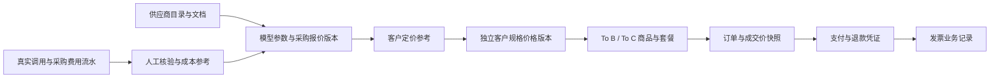

# 供应商模型元数据与成本库

## 目的与边界

供应商给出的模型ID、参数声明、采购报价与客户商品/积分售价分开维护。此库保存供应商参考资料，支持按供应商、家族、品牌、计费方式、能力信息状态和关键词筛选。当前入口 `/admin/mvp/library`，MVP工作台顶部可进入。当前目录自动发现只证明出现了模型ID，不证明参数或报价有效；库表保留未知值，不靠模型名称、catalog owner或客户展示别名猜品牌、能力和成本。

这是后续To B/To C销售平台的参考数据基础。商品、客户报价、订单、支付和发票仍应通过相应业务服务及自己的不可变交易快照维护；本轮没有实现新销售网站、支付或开票流程，也没有把上游成本直接当客户售价。

## 数据结构

- `app_supplier_model_metadata`：UUID身份，供应商来源ID + 实际模型ID唯一。家族/品牌/类型/能力状态为筛选列；完整参数、来源、报价等存于结构化metadata。revision用于乐观锁，记录同步与维护时间。
- `app_supplier_model_price_points`：与模型关联的规格报价行，保存质量/分辨率、按次/张/token/秒/帧、原币种CNY/USD、单价或输入/输出/缓存/图片输入每百万token成本。金额为numeric(30,0)百万分之一货币单位，不经JS浮点运算；null未知，0需明确填写。当前版本按原币种展示，不自动折算或修改客户积分。
- `app_supplier_model_metadata_versions`：每次保存的完整参数/价格快照、操作者、时间和操作指纹。相同操作ID重放不重复写，过期revision冲突返回409，不能覆盖其他管理员更新。同步形成的初始/补充记录也保留历史。

metadata JSON中的价格与规范化价格行在同一事务维护。价格行用于计费方式筛选和未来参考计算，历史快照用于追溯当时依据。数据库变更仅新增三表和索引，旧应用可以忽略；回滚不删元数据、不回灌数据库。

## 来源、同步与能力

能力采用三态：支持、不支持、未知；整份资料另标记未知/来自现有执行配置/文档声明/已验证。文档声明和已验证必须填写来源与核对日期；此标记由管理员依据资料或验证记录维护，本轮不自动触发收费探测。价格独立标记未知/估算/文档报价/已验证，已声明的报价必须提供完整字段和依据，按次价不能同时叠加token价。

基础能力包含生成、参考图/编辑、蒙版、图片理解、流式、质量、分辨率、比例、参考图上限和上下文长度。其他参数保存在parameterMetadata，如duration、fps、seed、输出格式、允许值、默认值和证据。该字段是参考信息，不会被直接当请求body执行；不接受密钥或认证字段。

“导入现有配置与缓存”复用当前执行配置和已有目录，无供应商网络请求。“发现目录并同步”调用原有安全目录传输，仅GET模型目录；失败保留既有记录并报告来源状态。原MVP来源目录发现会自动补入元数据库；写入连接在目录事务释放后才取得，避免并发刷新占满连接池。辅助库维护失败返回metadataSaved=false，不能导致目录本身失败。

目录初始记录保持能力、品牌和成本未知；owner单列保留，不能当品牌。现有执行参数与采购信息导入标记为配置/估算，不冒充实测。只有从未人工维护的初始未知记录可用当前配置补充；人工记录和已有报价不会被同步覆盖。暂不可用/目录消失的来源不删历史记录。

## 后续销售平台关系

后续绑定应使用稳定模型/规格ID和资料revision，订单/任务继续冻结客户价与模型配置。参考资料修改不能改写已成交订单、已接受任务或历史发票。公开商品目录只输出客户可购规格和销售价格；供应商成本与凭据保持管理员权限。

## 接口与验收

管理员API `/api/admin/mvp/library`：GET分页/组合筛选、id详情、history历史；POST sync/save。列表声明schemaVersion=1，可导出当前页完整参考记录。无管理员权限404，跨站写403；列表与详情不包含credentialRef或认证值。导出是当前筛选页，不冒充全量迁移。

`scripts/verify-supplier-model-metadata.ts` 使用隔离PostgreSQL核验DDL重复执行、目录自动入库、未知三态、配置补充、精确token价格、筛选、参数schema、修订/冲突/重放、人工记录保留及5个并发目录刷新。浏览器测试 `scripts/verify-supplier-model-metadata-ui.mjs` 验证真实保存/再读、来源与参数、输入输出缓存价格、五项筛选、导出、修订、手机弹窗和权限，确认原执行/完整草稿/客户价格不变。收费生成0。
